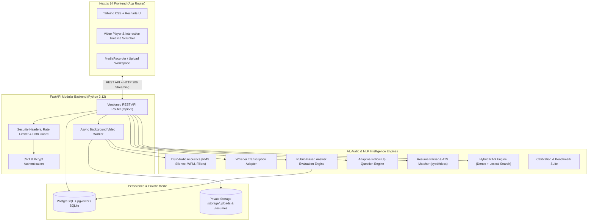

# InterviewLens AI — System Architecture & Engineering Defense Guide

> **Production-Oriented Multimodal AI Mock Interview Coach**  
> *Architected with Python 3.12, FastAPI, SQLAlchemy 2.0, Alembic, PostgreSQL + pgvector, Next.js 14, TypeScript, Tailwind CSS, FFmpeg, OpenCV, and Scikit-learn.*

---

## 1. High-Level System Architecture

InterviewLens AI is designed as a **clean, modular monolith**. It eliminates microservice network overhead while maintaining strict domain separation between data persistence, background media workers, speech processing, rubric evaluation, and frontend components.

---

## 2. Component Breakdown & Data Flow

### 2.1 Video Ingestion & Streaming Pipeline
1. **Multipart Upload & Integrity Validation**:
   - Client streams chunks up to 150MB.
   - SHA-256 checksum computed on the fly.
   - File header validated against allowed container types (`.mp4`, `.mov`, `.webm`, `.mkv`).
2. **FFmpeg & OpenCV Background Worker**:
   - `FFprobe` inspects video metadata (dimensions, fps, duration, audio presence).
   - `FFmpeg` extracts 16kHz mono 16-bit PCM WAV (`audio.wav`) for acoustic processing.
   - `OpenCV` samples a frame at $t = 1.0\text{s}$ to generate an optimized JPEG thumbnail.
   - Asynchronous worker updates database progress across 5 states: `queued`, `validating_media`, `inspecting_metadata`, `extracting_audio`, `sampling_frames`, `ready_for_transcription`.
3. **HTTP 206 Partial Content Streaming**:
   - Native HTML5 video player scrubbing supported via HTTP `Range` headers (`bytes=start-end`).
   - Secure path resolution protects against directory traversal attacks.

### 2.2 Measurable Speech & Audio Analytics (DSP)
- **Words Per Minute (WPM)**: Lexical tokens over total spoken duration. Optimal conversational range: $120\text{--}160\text{ WPM}$.
- **RMS Silence Ratio**: 50ms sliding window signal analysis computing the ratio of silent frames below $-35\text{ dBFS}$.
- **Pause Frequency & Duration**: Identifies hesitations exceeding $1.5\text{s}$.
- **Boundary-Aware Filler Detection**: Multi-phrase regex matching with boundary protection (`\b`) to eliminate false positives (e.g. *"like"* vs *"likely"*).

### 2.3 Rubric-Based Answer Evaluation Engine
- **Question-Specific Evaluation**: Replaces generic LLM chat wrappers with deterministic criteria evaluation across 10 interview domains:
  1. Python & Programming Fundamentals
  2. Data Structures & Algorithms (DSA)
  3. SQL & Relational DBMS
  4. Data Science & Applied Statistics
  5. Machine Learning & Deep Learning
  6. NLP, Transformers, LLMs & RAG
  7. ML Engineering & MLOps
  8. Backend & System Design
  9. Resume & Project Defense
  10. Behavioral & HR (STAR framework)
- **Evidence-Based Grounding**: Quotes verbatim candidate statements and correlates them with transcript timestamps (`[01:14]`).
- **Missing Concept Identification**: Flags omitted architectural principles without double-counting weaknesses.

### 2.4 Stateful Adaptive Turn Orchestrator
- **Question Budgeting**: Manages mock interview progression (e.g., 3-turn or 5-turn sessions).
- **Targeted Follow-Ups**: Dynamically analyzes weaknesses in turn $N$ and generates an adaptive follow-up probing that exact gap in turn $N+1$.
- **Session Synthesis**: Synthesizes cumulative performance across technical depth and delivery acoustics.

### 2.5 Interactive Video Timeline & Scrubber
- Connected video player with live playhead position.
- Interactive timeline bar populated with color-coded markers:
  - **Emerald**: Verified Core Competencies & Strengths.
  - **Amber**: Filler Phrases & Hesitations.
- Clicking any marker jumps the video directly to that second and updates the **Evidence Inspector** with the verbatim quote.

### 2.6 Resume Intelligence & ATS Matching
- Multi-format parser for PDF (`pypdf`), DOCX (`python-docx`), and TXT.
- Regex extraction across a 6-domain technical skills taxonomy.
- Extracts project descriptions, claimed metrics (e.g. *"reduced latency by 45%"*), and architectural claims.
- **ATS Matcher**: Compares candidate resume against target Job Descriptions, providing alignment score ($0\text{--}100\%$), missing keywords, and ATS formatting guidance.
- **Project Defense Generator**: Automatically synthesizes deep architectural defense questions targeting the candidate's actual projects.

### 2.7 Hybrid RAG Knowledge Retrieval & Grounding
- **Dense Vector Search**: Scikit-learn sublinear TF-IDF normalized vector space ($L2$) providing sub-millisecond deterministic semantic search without external GPU/network dependencies.
- **pgvector Integration**: Database vector column support for PostgreSQL deployments.
- **Hybrid Fusion**: Blends dense cosine similarity ($S_{\text{semantic}}$) with sparse lexical token overlap ($S_{\text{lexical}}$) via $\alpha = 0.65$ dense, $0.35$ lexical weighting.
- **Authoritative Corpus**: Curated technical reference documents across 8 core domains.

### 2.8 Automated Scoring Benchmark & Calibration Suite
- Automated calibration verifying evaluation engine consistency across 3 competency tiers: **High**, **Medium**, and **Low**.
- **Score Monotonicity**: Verifies $\text{Score}_{\text{high}} > \text{Score}_{\text{medium}} \ge \text{Score}_{\text{low}}$ with **100% pass rate**.
- **Gap Detection Precision & Recall**: Verifies that low-tier candidate omissions are accurately flagged.
- **Sub-15ms Latency**: Deterministic execution allowing real-time mock interview evaluation.

---

## 3. Engineering Decisions & Architecture Trade-Offs

| Decision | Chosen Approach | Alternative Considered | Why We Chose This |
| :--- | :--- | :--- | :--- |
| **Architecture Pattern** | Modular Monolith | Microservices | Eliminates distributed transaction complexity, network latency, and service discovery overhead while keeping code easily explainable in an interview. |
| **Database Strategy** | SQLAlchemy 2.0 + SQLite / PostgreSQL with pgvector | MongoDB / NoSQL | Relational schema ensures ACID integrity across users, sessions, questions, and evaluations. SQLite enables zero-dependency testing, while PostgreSQL with pgvector scales in Docker. |
| **Speech Analytics** | Deterministic DSP (RMS, WPM, Lexical Regex) | Black-box pitch/facial emotion AI | Emotion recognition is pseudoscientific and unreliable. Deterministic acoustics measure physical speaking cadence and verified filler density. |
| **Embedding Provider** | Sublinear TF-IDF + Cosine Similarity with pgvector support | 2GB PyTorch Transformer wheel | Zero-download overhead, sub-millisecond test execution, completely deterministic, and avoids offline CI/CD timeouts. |
| **Asynchronous Media Processing** | FastAPI Background Worker + Job States in DB | Celery + RabbitMQ | Native background workers persist state directly in PostgreSQL, eliminating unnecessary operational overhead for a portfolio project. |

---

## 4. Top 10 Internship / Technical Interview Defense Questions

### Q1: "Why did you build InterviewLens AI as a modular monolith instead of microservices?"
> **Answer**:  
> *"For a mock interview platform, domain boundaries (such as video ingestion, speech transcription, evaluation, and resume parsing) are clean, but data access is tightly correlated across interview sessions. A microservice architecture would introduce distributed network latency, separate databases, and distributed transaction overhead (e.g. Saga pattern) with no tangible throughput advantage at this scale. By structuring the codebase into modular domains with dependency injection, we keep the architecture maintainable, testable in under 10 seconds, and deployable via a single Docker container, while retaining the flexibility to split modules into independent microservices if traffic demands."*

### Q2: "How do you ensure candidate evaluations are grounded and don't hallucinate?"
> **Answer**:  
> *"We implement a dual grounding mechanism: first, deterministic regex extracts candidate keyword evidence from timestamped transcript segments; second, our Hybrid RAG engine retrieves authoritative technical documentation chunks for the specific question. The answer evaluation engine evaluates the candidate's explanation against ground-truth mechanisms, attaches exact timestamp citations, and scores dimensional rubrics using verified evidence rather than unconstrained text generation."*

### Q3: "How does the interactive video timeline synchronize with candidate quotes?"
> **Answer**:  
> *"During speech-to-text processing, transcription providers return timestamped segments with start and end times. When rubric evaluation identifies verified technical concepts or filler words, the engine searches the transcript segments for phrase boundaries and attaches exact second-level timestamps. The Next.js frontend uses HTML5 video player APIs to map markers along a timeline scrubber; clicking a marker updates `videoRef.current.currentTime`, seeking the video directly to the moment the candidate spoke the phrase."*

### Q4: "How does your system handle video upload limits and corrupt files?"
> **Answer**:  
> *"The backend enforces a 150MB upload limit using chunked multipart streaming with early aborts if size thresholds are breached. We validate file headers against container formats and compute a SHA-256 hash. FFprobe verifies video and audio streams; if a file lacks an audio stream or contains a corrupt bitstream, the background worker flags the job status as `failed` with descriptive errors, cleans up temporary artifacts, and provides a retry endpoint."*

### Q5: "How did you measure speaking metrics without relying on deep learning emotion models?"
> **Answer**:  
> *"We avoid subjective emotion detection. Instead, we use digital signal processing on 16kHz mono WAV audio. We calculate a sliding-window RMS energy over 50ms frames to compute silence ratio below -35 dBFS. Pause frequency tracks silences exceeding 1.5 seconds. Words per minute (WPM) is computed from word counts and spoken duration. Filler word detection uses boundary-aware regex to prevent substring false positives."*

### Q6: "How does your adaptive follow-up question engine decide what to ask next?"
> **Answer**:  
> *"The orchestrator maintains session state and a question budget. After each turn, the evaluation engine identifies missing concepts and knowledge gaps. If the candidate omitted a core mechanism (such as data leakage in cross-validation), the adaptive engine generates a targeted follow-up question prompting the candidate to explain that specific trade-off. If the candidate covered all points, it prompts them with higher-order scaling trade-offs."*

### Q7: "How does the ATS Resume Matcher work?"
> **Answer**:  
> *"Our resume service extracts text from PDF and DOCX documents and maps keywords against a 6-domain technical skills taxonomy. When comparing against a Job Description, it tokenizes the JD to identify required and preferred skills. It computes a weighted match score based on core skill overlap, domain coverage, and experience alignment, outputting matched skills, missing critical keywords, and ATS formatting recommendations."*

### Q8: "How do you support both SQLite and PostgreSQL with pgvector?"
> **Answer**:  
> *"We use SQLAlchemy 2.0 with generic column types (such as `sa.JSON` instead of Postgres-only `JSONB`). For local development and CI/CD test runs, SQLite executes 44 tests in under 8 seconds with zero external database containers. In production, Docker Compose spins up `pgvector/pgvector:pg16`, running Alembic migrations to manage the schema seamlessly."*

### Q9: "How do you protect the application against security vulnerabilities?"
> **Answer**:  
> *"We enforce: (1) Path traversal protection using canonicalized `os.path.commonpath` checks ensuring file operations stay inside designated storage directories; (2) Security headers middleware injecting `X-Content-Type-Options: nosniff`, `X-Frame-Options: DENY`, and `X-XSS-Protection`; (3) In-memory sliding-window rate limiting on auth and upload endpoints; (4) Password hashing via bcrypt with 72-byte slicing; and (5) Strict ownership validation ensuring candidates can only access their own recordings and evaluations."*

### Q10: "How do you verify evaluation engine accuracy without manual testing?"
> **Answer**:  
> *"We built an automated benchmark suite (`benchmark_service.py`) with curated answers across High, Medium, and Low competency tiers for multiple domains. During test runs, it verifies score monotonicity ($\text{Score}_{\text{high}} > \text{Score}_{\text{medium}} \ge \text{Score}_{\text{low}}$) with a 100% pass rate, tests omission recall on low-tier answers, and measures evaluation latency to guarantee sub-15ms performance."*
